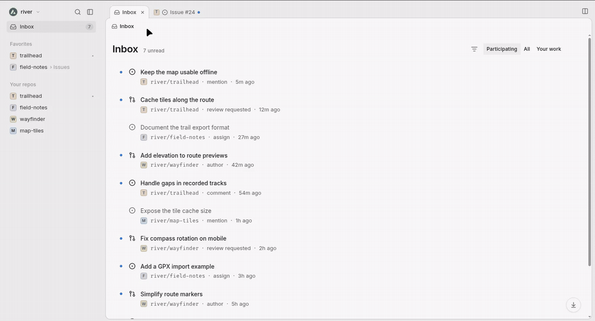
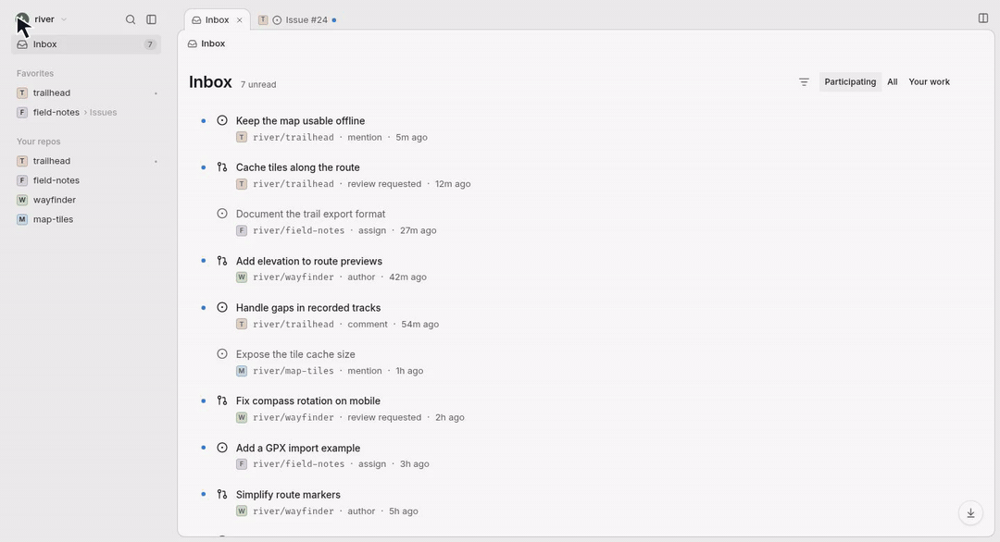
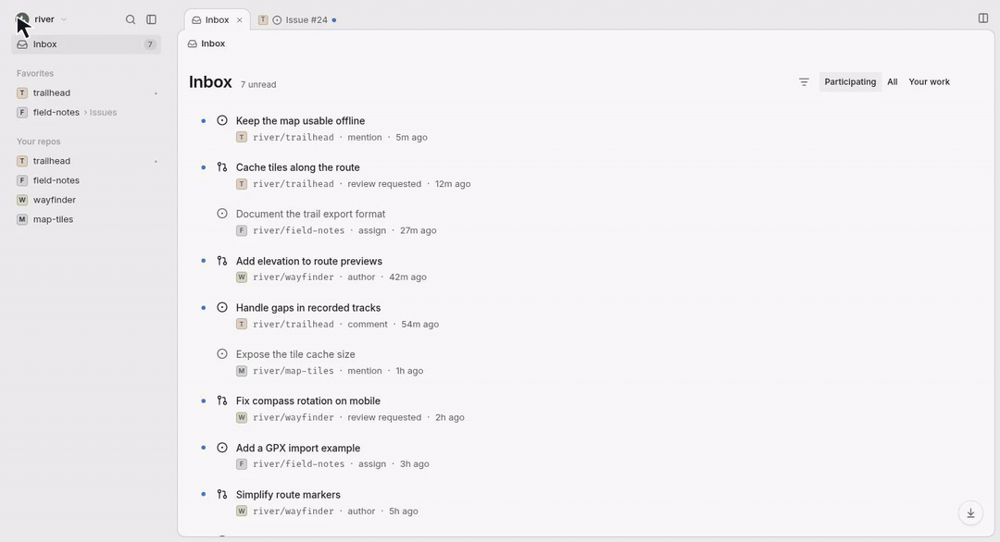
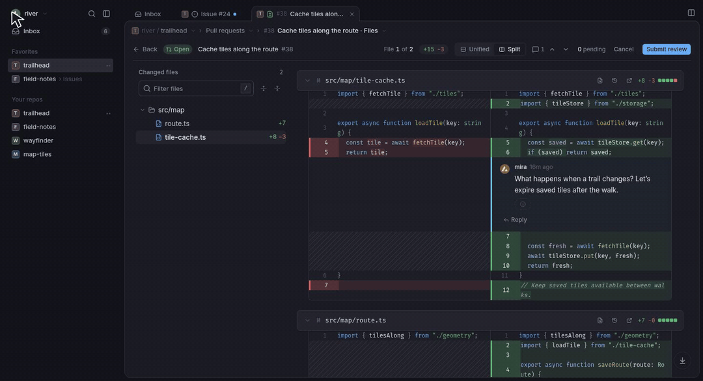
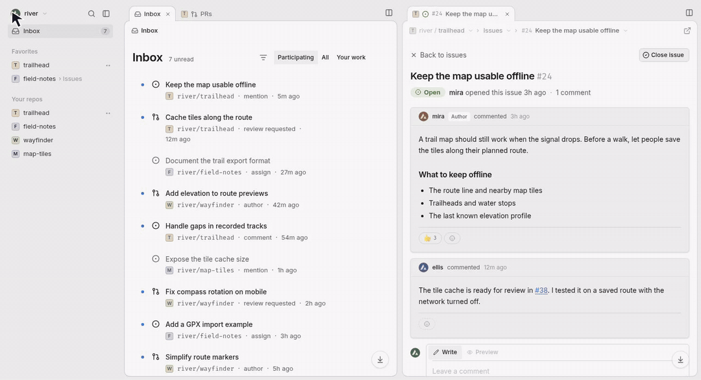

<p align="center">
  
</p>

<h1 align="center">GitHut</h1>

<p align="center">A keyboard-friendly workspace for GitHub issues, pull requests, and code.</p>

<p align="center">
  <a href="https://githut.app"><strong>Open GitHut</strong></a> ·
  <a href="#demos">Demos</a> ·
  <a href="#run-locally">Run locally</a> ·
  <a href="CONTRIBUTING.md">Contribute</a>
</p>

GitHut brings your GitHub repositories into one browser window. Read an issue beside your Inbox, open the pull request that fixes it, and review the diff without losing your place. [Sign in with GitHub](https://githut.app) to use your existing repositories and notifications.

## Demos

**Drag a tab to dock it.** Hold the issue tab, drag it to the right edge, and release when the split preview appears. GitHut calls each group of tabs an *island*.

<picture>
  <source media="(prefers-reduced-motion: reduce)" srcset="docs/screenshots/workspace.png">
  
</picture>

[View a still image](docs/screenshots/workspace.png) · [Dock using the tab menu](docs/demos/workspace.gif)

<details>
<summary><strong>Open a pull request</strong> · Inbox → conversation → changed files</summary>



</details>

<details>
<summary><strong>Use the tab context menu</strong> · Right-click to pin a tab</summary>



</details>

<details>
<summary><strong>Filter the Inbox</strong> · Combine a notification type and a repository</summary>


</details>

<details>
<summary><strong>Review a diff</strong> · Switch layouts and jump between files</summary>



[View a still image of an inline review](docs/screenshots/review.png)

</details>

<details>
<summary><strong>Switch themes</strong> · Try dark mode, Catppuccin, and Ember</summary>



</details>

For repository triage, use **Display → Grouping** to organize issues and pull requests by assignee, label, or milestone. For a failing build, open **Actions** and select a job to read its step logs.

Press **Ctrl K** (**⌘ K** on macOS) to open the command palette, or **?** for the shortcuts on the current page.

## Run locally

You’ll need [Bun](https://bun.sh), Node.js 22.12 or later, and a GitHub account.

1. Clone the repository and install its dependencies:

   ```sh
   git clone https://github.com/daedlock/githut.git
   cd githut
   bun install --frozen-lockfile
   cp .dev.vars.example .dev.vars
   ```

2. [Register a GitHub OAuth app](https://github.com/settings/applications/new) for local development. Set its **Homepage URL** to `http://localhost:5173` and its **Authorization callback URL** to `http://localhost:5173/api/auth/callback`.

3. In `.dev.vars`, fill in `GITHUB_CLIENT_ID` and `GITHUB_CLIENT_SECRET` from that OAuth app. For `OAUTH_STATE_SECRET`, generate a separate value with `openssl rand -hex 32`. This file is ignored by Git.

4. Build the static assets once, then start Vite and the local Cloudflare Worker:

   ```sh
   bun run build
   bun run dev
   ```

   Open [localhost:5173](http://localhost:5173) and sign in. The Worker handles the OAuth callback; the browser uses the resulting token to call GitHub. GitHut requests the `repo`, `read:user`, and `read:org` scopes, so authorized actions such as posting a review also appear on GitHub.

## Contributing

The [React app](src/app) uses TanStack Router and Query for navigation and GitHub data, and Shiki for code highlighting. The [Cloudflare Worker](src/worker) handles sign-in and uploads. Run `bun test` and `bunx tsc --noEmit` to check your changes.

Read the [contributing guide](CONTRIBUTING.md), [report a bug](https://github.com/daedlock/githut/issues/new?template=bug_report.md), or [suggest a feature](https://github.com/daedlock/githut/issues/new?template=feature_request.md).

GitHut is licensed under the [MIT License](LICENSE).
