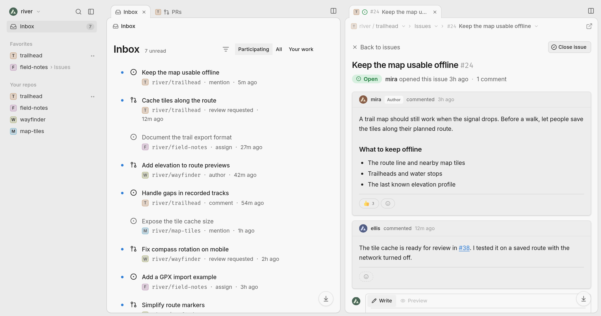
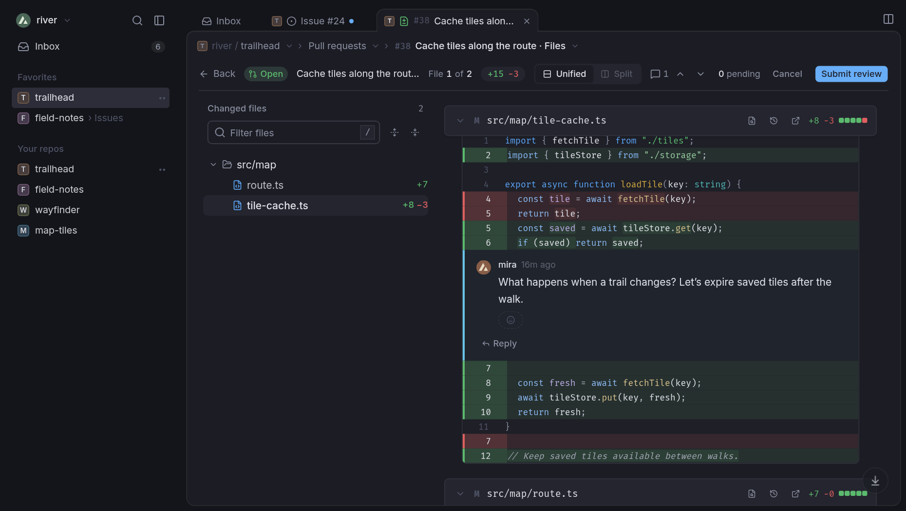

<p align="center">
  
</p>

<h1 align="center">GitHut</h1>

<p align="center">A keyboard-friendly workspace for GitHub issues, pull requests, and code.</p>

<p align="center">
  <a href="https://githut.app"><strong>Open GitHut</strong></a> ·
  <a href="#run-locally">Run locally</a> ·
  <a href="CONTRIBUTING.md">Contribute</a>
</p>

GitHut brings the repositories you work on into one browser window. Keep your Inbox open on the left, read an issue on the right, and open the pull request that fixes it in its own tab. Sign in with GitHub to use your existing repositories, notifications, and reviews.



## Find your next task

- **Start in the Inbox.** Filter notifications by repository, type, or who’s involved. Switch to **Your work** for review requests and your own open pull requests.
- **Keep related pages together.** Drag a tab to the edge of the workspace to open it beside the current page. GitHut calls these groups *islands*. Each island has its own tabs. Pin a tab you want to keep open, or favorite a repository or page to find it again from the sidebar.
- **Triage a busy repository.** Group issues or pull requests by label, assignee, or milestone under **Display → Grouping**. Collapse the groups you don’t need, then use **J** and **K** to move through the remaining rows.

## Review a change

Browse the source on any branch, or open a file’s history to see when it changed. In a pull request, move from the conversation to the changed files. Switch between unified and split diffs, leave a comment on a line, and submit your review. To investigate a failure, open the repository’s **Actions** section and drill into the run, job, and step logs.



**Keyboard tip:** Press **Ctrl K** (**⌘ K** on macOS) to open the command palette, or **?** to see the shortcuts for the current page.

## Run locally

You’ll need [Bun](https://bun.sh), Node.js 22.12 or later, and a GitHub account.

1. Clone the repository and install its dependencies:

   ```sh
   git clone https://github.com/daedlock/githut.git
   cd githut
   bun install --frozen-lockfile
   cp .dev.vars.example .dev.vars
   ```

2. [Register a GitHub OAuth app](https://github.com/settings/applications/new) for local development. Set its **Homepage URL** to `http://localhost:5173` and its **Authorization callback URL** to `http://localhost:5173/api/auth/callback`.

3. In `.dev.vars`, fill in `GITHUB_CLIENT_ID` and `GITHUB_CLIENT_SECRET` from that OAuth app. For `OAUTH_STATE_SECRET`, generate a separate value with `openssl rand -hex 32`. This file is ignored by Git.

4. Build the static assets once, then start Vite and the local Cloudflare Worker:

   ```sh
   bun run build
   bun run dev
   ```

   Open [localhost:5173](http://localhost:5173) and sign in. The Worker handles the OAuth callback; the browser uses the resulting token to call GitHub. GitHut requests the `repo`, `read:user`, and `read:org` scopes, so authorized actions such as posting a review also appear on GitHub.

## Contributing

The [React app](src/app) uses TanStack Router and Query for navigation and GitHub data, and Shiki for code highlighting. The [Cloudflare Worker](src/worker) handles sign-in and uploads. Run `bun test` and `bunx tsc --noEmit` to check your changes.

Read the [contributing guide](CONTRIBUTING.md), [report a bug](https://github.com/daedlock/githut/issues/new?template=bug_report.md), or [suggest a feature](https://github.com/daedlock/githut/issues/new?template=feature_request.md).

GitHut is licensed under the [MIT License](LICENSE).
